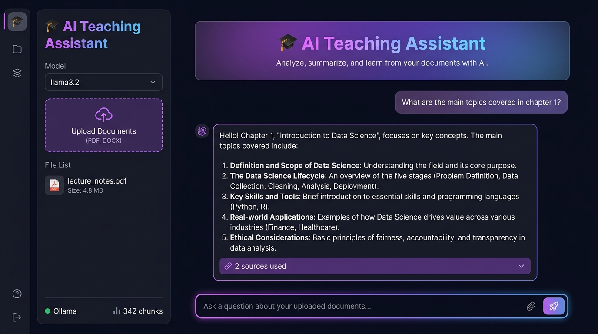
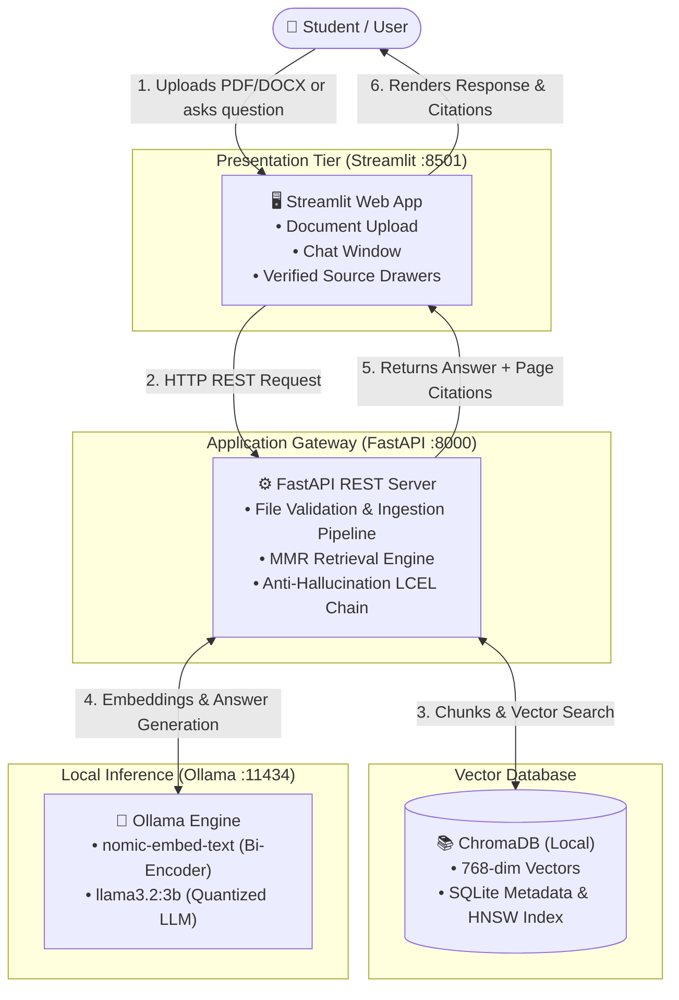

<div align="center">

# 🎓 AI Teaching Assistant — Local RAG Knowledge Engine

### *Transform your textbooks, lecture slides, and notes into an interactive private AI tutor.*

[](https://www.python.org/)
[](https://fastapi.tiangolo.com/)
[](https://streamlit.io/)
[](https://www.langchain.com/)
[](https://www.trychroma.com/)
[](https://ollama.ai/)
[](https://opensource.org/licenses/MIT)

<br/>



<br/>

[Key Highlights](#-key-highlights) •
[System Architecture](#-system-architecture) •
[Quickstart](#-quickstart) •
[Developer Profile](#-about-the-developer) •
[API Reference](#-api-documentation)

</div>

---

## 🌟 Key Highlights

- 🔒 **100% Private & Local:** Zero cloud dependency, zero external API keys, zero token fees. All documents, embeddings, and inference stay on your device.
- 🎯 **Grounded, Anti-Hallucination Answers:** Low temperature decoding (`0.1`) combined with a strict pedagogical system prompt ensures the assistant only answers from your materials.
- 📚 **Multi-Format Document Parsing:** Seamlessly parses text and metadata from PDF (`PyMuPDF`) and Word documents (`python-docx`).
- 🔎 **Maximal Marginal Relevance (MMR):** Avoids redundant chunks by selecting diverse, high-novelty context snippets (`fetch_k=15, k=4`).
- 📎 **Verifiable Source Citations:** Every answer references the source document name and exact page numbers.
- 🎨 **Modern Glassmorphic Dark UI:** Streamlit interface styled with custom CSS, real-time health diagnostics, and document manager.

---

## 🏗️ System Architecture



---

## 🛠️ Tech Stack & Components

| Component | Technology | Description |
|---|---|---|
| **Presentation** | [Streamlit](https://streamlit.io/) | Interactive dark-mode frontend with chat session state and citation cards |
| **Backend API** | [FastAPI](https://fastapi.tiangolo.com/) + [Uvicorn](https://www.uvicorn.org/) | High-performance asynchronous REST API gateway with OpenAPI documentation |
| **Orchestration** | [LangChain](https://www.langchain.com/) (>= 0.3) | LCEL chain composition, prompt templates, and retriever bindings |
| **Vector Database** | [ChromaDB](https://www.trychroma.com/) (>= 0.5) | Local persistent vector store (SQLite metadata + HNSW vector index) |
| **Document Parsers** | [PyMuPDF](https://pymupdf.readthedocs.io/) & [Docx2txt](https://pypi.org/project/docx2txt/) | High-speed PDF page-by-page extraction & Word document parser |
| **Embedding Model** | `nomic-embed-text` (via Ollama) | 768-dimensional normalized dense semantic representations |
| **Language Model** | `llama3.2:3b` (via Ollama) | Meta's 4-bit quantized instruction-tuned LLM running locally |

---

## 🚀 Quickstart

### Prerequisites
1. **Python 3.10+** installed
2. **Ollama** installed from [ollama.ai](https://ollama.ai)

### 1. Clone & Set Up Environment
```bash
git clone https://github.com/Narendrabharambe23/ai-teaching-assistant-.git
cd ai-teaching-assistant-

# Create virtual environment
python -m venv .venv
# Windows:
.venv\Scripts\activate
# Mac/Linux:
source .venv/bin/activate

# Install dependencies
pip install -r requirements.txt
```

### 2. Pull Local AI Models
```bash
ollama pull nomic-embed-text
ollama pull llama3.2
```

### 3. Launch Services

**Terminal 1 — Ollama Daemon (if not running in system tray):**
```bash
ollama serve
```

**Terminal 2 — FastAPI Backend:**
```bash
uvicorn backend.main:app --reload --host 127.0.0.1 --port 8000
```
*API Swagger Docs:* `http://127.0.0.1:8000/docs`

**Terminal 3 — Streamlit Frontend:**
```bash
streamlit run frontend/streamlit_app.py
```
*Web Application:* `http://localhost:8501`

---

## 📖 How It Works (Step-by-Step)

```
[Upload Document] ➔ PyMuPDF Extract ➔ 800-char Chunks (150 Overlap) ➔ nomic-embed-text ➔ ChromaDB
[Ask Question]    ➔ Embed Query ➔ MMR Vector Search (Top 4) ➔ Strict Prompt ➔ Llama 3.2 ➔ Answer + Page Citations
```

1. **Ingestion:** Upload a PDF or DOCX file. The system validates text density (rejects empty or scanned image PDFs), splits it into 800-character semantic chunks with 150-character overlap, generates 768-dim embeddings, and persists them into ChromaDB.
2. **Retrieval:** When a question is submitted, ChromaDB runs **Maximal Marginal Relevance (MMR)** (`fetch_k=15, k=4`), selecting the 4 most informative, non-redundant passages.
3. **Generation:** Llama 3.2 generates an answer strictly based on the retrieved context, citing exact source files and page numbers.

---

## 📁 Repository Structure

```text
ai-teaching-assistant/
├── backend/
│   ├── api/v1/endpoints/        # REST API endpoints (chat, documents)
│   ├── core/config.py           # Pydantic BaseSettings singleton
│   ├── models/schemas.py        # Request & Response Pydantic DTOs
│   ├── services/
│   │   ├── ingestion_service.py # PDF/Word loading, chunking & ChromaDB storage
│   │   └── llm_service.py       # MMR retrieval, strict teaching prompt & LCEL chain
│   └── main.py                  # FastAPI application entry point & CORS
├── frontend/
│   ├── components/
│   │   ├── chat_interface.py    # Chat bubbles, input box & expandable source citations
│   │   └── sidebar.py           # File uploader, model switch & health diagnostics
│   └── streamlit_app.py         # Streamlit main UI entry & glassmorphic CSS
├── docs/assets/                 # Architecture & UI preview graphics
├── data/                        # Persistent local data (raw documents & vector db)
├── requirements.txt             # Project dependencies
└── README.md                    # Project documentation
```

---

## 📡 API Documentation

| Method | Endpoint | Description |
|---|---|---|
| `GET` | `/health` | System diagnostics (Ollama connectivity, collection chunk count) |
| `POST` | `/api/v1/documents/upload` | Upload and ingest a PDF/DOCX file (<50MB) |
| `GET` | `/api/v1/documents/` | List all ingested documents with metadata & timestamps |
| `DELETE` | `/api/v1/documents/clear` | Purge entire vector database and delete uploaded files |
| `POST` | `/api/v1/chat/` | Submit a student question; returns grounded answer & citations |

---

## 👨‍💻 About the Developer

<div align="center">

### **Narendra Bharambe**
*AI & Software Engineer | Data Science & Generative AI Enthusiast*

[](https://github.com/Narendrabharambe23)
[](https://www.linkedin.com)
[](https://github.com/Narendrabharambe23)

*Building private, high-performance AI systems that empower learning and solve real-world problems.*

</div>

---

<div align="center">
⭐ If you find this project helpful, please consider starring this repository!
</div>
